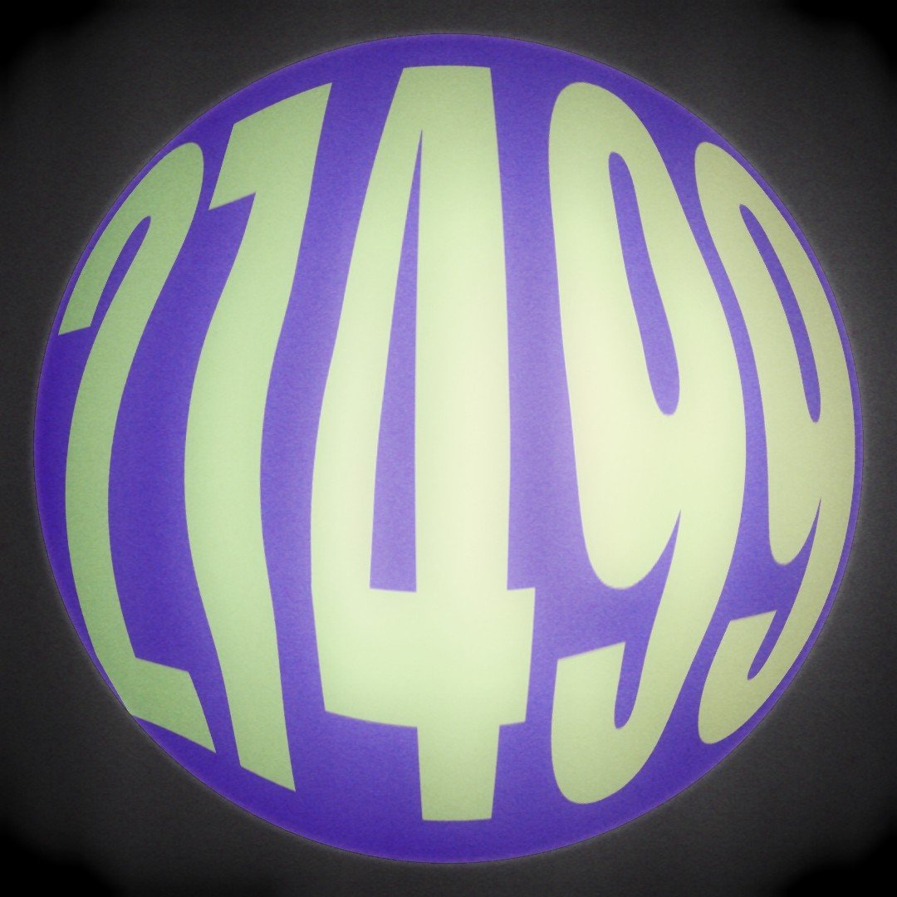

<!DOCTYPE html>
<html lang="en">
<head>
  <meta charset="UTF-8">
  <meta name="viewport" content="width=device-width, initial-scale=1">
  <title>Harvest Robotics — FTC Team 27499</title>
  
</head>
<body>
  <header>
    

      
      <nav aria-label="Main navigation">
        <a href="#about">About</a>
        <a href="#robotics">Robotics</a>
        <a href="#competition">Competition</a>
        <a href="#contact">Contact</a>
      </nav>
    

  </header>

  <main id="top">
    

      
Harvest Collegiate · New York City

      <h1>Harvest Robotics</h1>
      
We are FIRST Tech Challenge Team 27499, a student robotics team from New York City.

      

        <strong>Team number:</strong> 27499
        <strong>Program:</strong> FIRST Tech Challenge
        <strong>Rookie year:</strong> 2024
      

    

    <section id="about">
      <h2>About the Team</h2>
      
Harvest Robotics is the robotics team at Harvest Collegiate. We take part in the FIRST Tech Challenge, where student teams design, build, program, and operate robots to complete a new challenge each season.

      
Our team is based in New York, NY, and began competing in 2024.

    </section>

    <section id="robotics">
      <h2>What We Do</h2>
      
Robotics involves more than building a machine. Team members work together on the different parts of a competition robot, including:

      <ul class="plain-list">
        <li>Robot design and construction</li>
        <li>Programming and testing</li>
        <li>Problem-solving and troubleshooting</li>
        <li>Preparing for competitions</li>
        <li>Working as a team and documenting our work</li>
      </ul>
    </section>

    <section id="competition">
      <h2>FIRST Tech Challenge</h2>
      
FIRST Tech Challenge is a robotics program for students. Teams build robots and compete in matches that involve both autonomous programming and driver control.

      
Team 27499 has competed in New York City qualifying events. You can find official team and event information here:

      <ul class="plain-list links">
        <li><a href="https://ftc-events.firstinspires.org/team/27499" target="_blank" rel="noopener noreferrer">Harvest Robotics — official FIRST team page</a></li>
        <li><a href="https://www.firstinspires.org/robotics/ftc" target="_blank" rel="noopener noreferrer">About FIRST Tech Challenge</a></li>
      </ul>
    </section>

    <section id="contact">
      <h2>Contact</h2>
      

        Interested in the team or want to learn more? Contact the Harvest Collegiate faculty or school office for information about joining and team activities.
      

    </section>
  </main>

  <footer>
    
Harvest Robotics · FIRST Tech Challenge Team 27499

    
Harvest Collegiate · New York, NY

  </footer>
</body>
</html>
